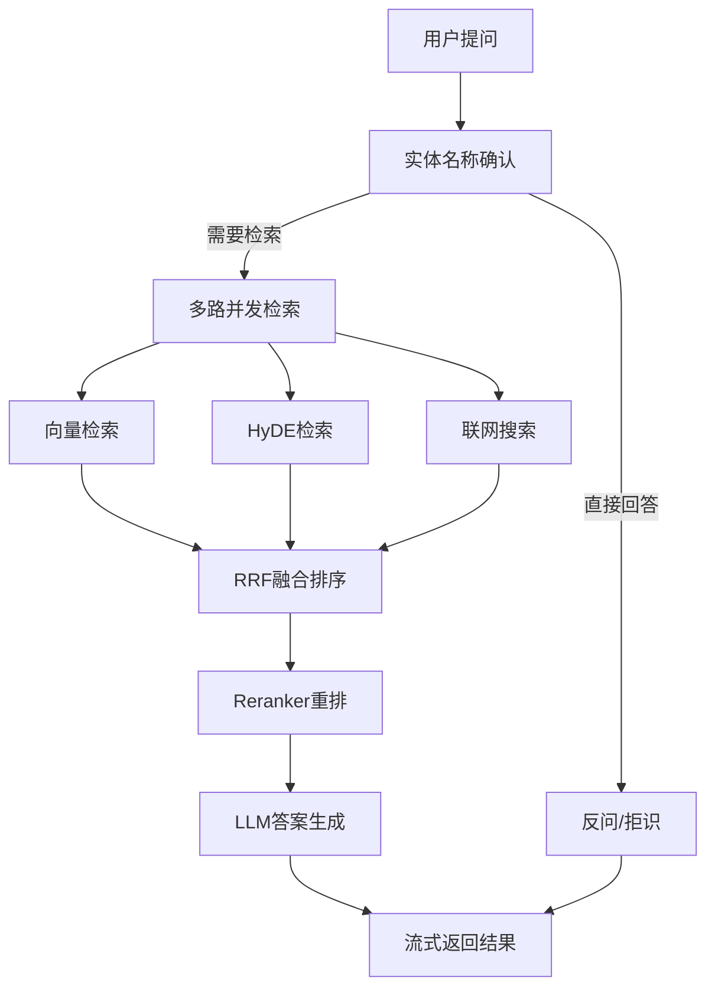

# 🧠 Knowledge Brain - 智能知识大脑系统

<div align="center">

**基于 RAG 与多策略检索融合的领域智能问答系统**

[](https://www.python.org/)
[](LICENSE)
[](https://fastapi.tiangolo.com/)
[](https://python.langchain.com/)
[](https://github.com/langchain-ai/langgraph)

</div>

---

## 📖 项目简介

**Knowledge Brain** 是一个基于大语言模型的智能知识大脑系统，专注于构建端到端的 AI 知识处理闭环。系统采用 **LangGraph** 实现复杂工作流编排，支持**多路召回**（向量检索 + HyDE + 联网搜索）、**RRF 融合排序**、**Reranker 二次精排**，并集成 **Ragas** 框架进行五维量化评估。

### ✨ 核心特性

- 🔄 **智能工作流编排**: 基于 LangGraph 构建结构化 AI Agent 工作流
- 🔍 **多策略检索融合**: 向量检索 + HyDE（假设性文档嵌入） + 联网搜索三路并发召回
- 🎯 **精准排序**: RRF（倒数排名融合） + Reranker 交叉编码器二次精排
- 📊 **量化评估**: Ragas 五维指标（Faithfulness、Answer Relevancy、Context Precision、Context Recall、Answer Correctness）
- 🧩 **模块化设计**: 三层架构分离（核心框架层、业务适配层、数据层）
- 💬 **流式输出**: 支持 SSE 实时流式返回
- 📁 **多格式支持**: PDF、Markdown 文档自动解析与处理

---

## 🏗️ 系统架构

### 整体架构

```
┌─────────────────────────────────────────────────────────┐
│                     应用层 (Web API)                      │
│  ┌──────────────┐  ┌──────────────┐  ┌──────────────┐  │
│  │  导入服务     │  │  查询服务     │  │  评估模块     │  │
│  │  :8000       │  │  :8001       │  │  eval_rag.py │  │
│  └──────────────┘  └──────────────┘  └──────────────┘  │
└─────────────────────────────────────────────────────────┘
                            ↓
┌─────────────────────────────────────────────────────────┐
│                  核心处理层 (Processor)                   │
│  ┌──────────────────────────────────────────────────┐  │
│  │  导入工作流 (Import Processor)                    │  │
│  │  Entry → PDF转MD → 图片理解 → 文档切分 →          │  │
│  │  实体识别 → BGE Embedding → Milvus入库            │  │
│  └──────────────────────────────────────────────────┘  │
│  ┌──────────────────────────────────────────────────┐  │
│  │  查询工作流 (Query Processor)                     │  │
│  │  实体确认 → 并发检索(向量+HyDE+联网) →            │  │
│  │  RRF融合 → Reranker重排 → 答案生成                │  │
│  └──────────────────────────────────────────────────┘  │
└─────────────────────────────────────────────────────────┘
                            ↓
┌─────────────────────────────────────────────────────────┐
│                      数据层 (Storage)                    │
│  ┌──────────────┐  ┌──────────────┐  ┌──────────────┐  │
│  │  Milvus      │  │  MongoDB     │  │  MinIO       │  │
│  │  向量数据库   │  │  历史对话     │  │  对象存储     │  │
│  └──────────────┘  └──────────────┘  └──────────────┘  │
└─────────────────────────────────────────────────────────┘
```

### 查询工作流详解



---

## 🛠️ 技术栈

### 核心框架

| 技术 | 版本 | 用途 |
|------|------|------|
| **Python** | 3.11+ | 开发语言 |
| **LangChain** | 1.3+ | LLM 应用框架 |
| **LangGraph** | 1.2+ | 工作流编排 |
| **FastAPI** | 0.141+ | Web 框架 |
| **PyTorch** | 2.11+ | 深度学习模型运行 |

### AI 模型与工具

| 技术 | 用途 |
|------|------|
| **BGE-M3** | 稠密+稀疏混合向量嵌入 |
| **BGE-Reranker** | 交叉编码器重排序 |
| **Qwen (通义千问)** | 默认 LLM（支持 OpenAI 格式） |
| **ModelScope** | 本地模型加载 |
| **Ragas** | RAG 系统量化评估 |

### 数据存储

| 技术 | 用途 |
|------|------|
| **Milvus** | 向量数据库 |
| **MongoDB** | 对话历史存储 |
| **MinIO** | 对象存储 |

---

## 📦 安装指南

### 1. 环境要求

- Python 3.11+
- CUDA 支持（推荐，用于加速 Embedding 模型）
- Git

### 2. 克隆项目

```bash
git clone https://github.com/Qw462/knowledge_brain.git
cd knowledge_brain
```

### 3. 安装依赖

使用 [uv](https://github.com/astral-sh/uv) 管理依赖：

```bash
# 安装 uv（如未安装）
pip install uv

# 安装所有依赖
uv sync

# 或使用 pip
pip install -r requirements.txt
```

> **注意**: PyTorch 系列包默认从 NVIDIA CUDA 12.8 源安装，如需其他版本请修改 `pyproject.toml`

### 4. 配置环境变量

复制环境变量示例文件：

```bash
cp .env.example.py .env
```

编辑 `.env` 文件，配置以下关键项：

```python
# LLM 配置
OPENAI_API_KEY=sk-your-api-key
OPENAI_API_BASE=https://dashscope.aliyuncs.com/compatible-mode/v1
LLM_DEFAULT_MODEL=qwen-max
LLM_DEFAULT_TEMPERATURE=0.1

# 模型路径
BGE_M3_PATH=/path/to/bge-m3
BGE_RERANKER_LARGE=/path/to/bge-reranker-large

# 数据库配置
MILVUS_URL=http://localhost:19530
MONGO_URL=mongodb://localhost:27017
MINIO_ENDPOINT=localhost:9000
```

### 5. 下载模型

```bash
# 使用 ModelScope 下载 BGE-M3 模型
python tool/download_bgem3.py
```

---

## 🚀 快速开始

### 启动导入服务

```bash
# 启动知识库导入 API（端口 8000）
python web/api/import_service.py
```

访问：
- 📄 **导入页面**: http://localhost:8000/import.html
- 📚 **API 文档**: http://localhost:8000/docs

### 启动查询服务

```bash
# 启动知识查询 API（端口 8001）
python web/api/query_service.py
```

访问：
- 💬 **对话页面**: http://localhost:8001/chat.html
- 📚 **API 文档**: http://localhost:8001/docs

### 运行 RAG 评估

```bash
# 执行 Ragas 五维指标评估
python eval/eval_rag.py
```

评估结果将保存至 `eval/qa_result.csv`

---

## 📂 项目结构

```
knowledge_brain/
├── config/                      # 配置模块
│   ├── bailian_mcp_config.py    # 百炼 MCP 配置
│   ├── embedding_config.py      # Embedding 模型配置
│   ├── lm_config.py             # LLM 配置
│   ├── milvus_config.py         # Milvus 配置
│   ├── mineru_config.py         # MineRU 配置
│   ├── minio_config.py          # MinIO 配置
│   └── reranker_config.py       # Reranker 配置
├── processor/                   # 核心处理器
│   ├── import_processor/        # 导入工作流
│   │   ├── nodes/               # 导入节点
│   │   │   ├── node_bge_embedding.py
│   │   │   ├── node_document_split.py
│   │   │   ├── node_import_milvus.py
│   │   │   ├── node_item_name_recognition.py
│   │   │   ├── node_md_img.py
│   │   │   └── node_pdf_to_md.py
│   │   ├── base.py              # 节点基类
│   │   ├── main_graph.py        # 导入主图
│   │   └── state.py             # 状态定义
│   └── query_processor/         # 查询工作流
│       ├── nodes/               # 查询节点
│       │   ├── node_answer_output.py
│       │   ├── node_item_name_confirm.py
│       │   ├── node_rerank.py
│       │   ├── node_rrf.py
│       │   ├── node_search_embedding.py
│       │   ├── node_search_embedding_hyde.py
│       │   └── node_web_search_mcp.py
│       ├── prompt/              # 提示词模板
│       ├── main_graph.py        # 查询主图
│       └── state.py             # 状态定义
├── utils/                       # 工具类
│   ├── embedding_utils.py       # Embedding 工具
│   ├── llm_utils.py             # LLM 工具
│   ├── milvus_utils.py          # Milvus 工具
│   ├── minio_utils.py           # MinIO 工具
│   ├── mongo_history_utils.py   # MongoDB 历史工具
│   ├── reranker_utils.py        # Reranker 工具
│   └── sse_utils.py             # SSE 工具
├── web/                         # Web 服务
│   ├── api/                     # API 接口
│   │   ├── import_service.py    # 导入服务
│   │   └── query_service.py     # 查询服务
│   └── page/                    # 前端页面
│       ├── chat.html
│       └── import.html
├── eval/                        # 评估模块
│   ├── eval_rag.py              # Ragas 评估脚本
│   ├── qa.csv                   # 测试集
│   └── qa_result.csv            # 评估结果
├── tool/                        # 辅助工具
│   ├── download_bgem3.py        # 模型下载
│   └── logger.py                # 日志工具
├── .env                         # 环境变量
├── pyproject.toml               # 项目配置
└── README.md                    # 项目说明
```

---

## 🔬 核心模块说明

### 1. 导入工作流 (Import Processor)

**职责**: 将原始文档（PDF/MD）解析、切分、向量化并入库

**处理流程**:
1. **文档类型判断** (`node_entry`): 识别 PDF 或 Markdown
2. **PDF 转 Markdown** (`node_pdf_to_md`): 使用 MineRU 解析 PDF
3. **图片理解** (`node_md_img`): 使用 VL 模型提取图片语义
4. **文档切分** (`node_document_split`): 按 800 字符切片
5. **实体识别** (`node_item_name_recognition`): LLM 提取关键实体
6. **向量化** (`node_bge_embedding`): BGE-M3 生成稠密+稀疏向量
7. **入库** (`node_import_milvus`): 存入 Milvus 向量数据库

### 2. 查询工作流 (Query Processor)

**职责**: 接收用户提问，多策略检索并生成回答

**处理流程**:
1. **实体确认** (`node_item_name_confirm`): 识别并确认查询主体
2. **并发检索**:
   - 向量检索 (`node_search_embedding`)
   - HyDE 检索 (`node_search_embedding_hyde`)
   - 联网搜索 (`node_web_search_mcp`)
3. **RRF 融合** (`node_rrf`): 倒数排名融合多路结果
4. **Reranker 重排** (`node_rerank`): 交叉编码器精排
5. **答案生成** (`node_answer_output`): LLM 生成最终回答

### 3. 评估模块 (Eval)

**基于 Ragas 框架的五维量化评估**:

| 指标 | 说明 |
|------|------|
| **Faithfulness** | 答案是否基于上下文中的事实 |
| **Answer Relevancy** | 答案与问题的相关程度 |
| **Context Precision** | 上下文中相关信息的排序质量 |
| **Context Recall** | 上下文对标准答案的覆盖程度 |
| **Answer Correctness** | 答案与标准答案的整体正确性 |

---

## 📊 性能优化建议

### 1. 切片大小调整

根据文档类型调整 `import_config.py` 中的切片参数：

```python
# 产品手册类文档
max_content_length = 2000
min_content_length = 500

# 旅游介绍类文档（推荐）
max_content_length = 800
min_content_length = 200
```

### 2. GPU 加速

确保 `.env` 中配置正确：

```python
BGE_DEVICE=cuda:0
BGE_FP16=True
BGE_RERANKER_DEVICE=cuda:0
BGE_RERANKER_FP16=1
```

### 3. 答案质量优化

在 `answer_prompt.py` 中强调简洁性：

```python
"请简洁回答，只说明与问题直接相关的内容，避免冗长发散"
```

---

## 🤝 贡献指南

欢迎贡献！请按以下步骤：

1. Fork 本仓库
2. 创建特性分支 (`git checkout -b feature/AmazingFeature`)
3. 提交更改 (`git commit -m 'Add some AmazingFeature'`)
4. 推送到分支 (`git push origin feature/AmazingFeature`)
5. 开启 Pull Request

---

## 📝 许可证

本项目采用 MIT 许可证 - 详见 [LICENSE](LICENSE) 文件

---

## 📧 联系方式

- **GitHub Issues**: [新建 Issue](https://github.com/Qw462/knowledge_brain/issues)
- **Gitee Issues**: [新建 Issue](https://gitee.com/zyx_666/knowledge_brain/issues)

---

## 🙏 致谢

- [LangChain](https://github.com/langchain-ai/langchain) - LLM 应用开发框架
- [LangGraph](https://github.com/langchain-ai/langgraph) - 工作流编排引擎
- [FlagEmbedding](https://github.com/FlagOpen/FlagEmbedding) - BGE 系列模型
- [Ragas](https://github.com/explodinggradients/ragas) - RAG 评估框架
- [Milvus](https://milvus.io/) - 向量数据库

---

<div align="center">

**如果这个项目对你有帮助，请给一个 ⭐️ Star 支持！**

</div>
